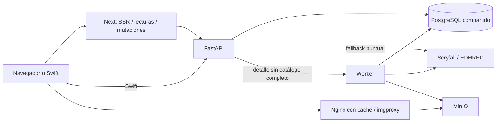

# Auditoría de arquitectura y rendimiento

Fecha: 30 de septiembre de 2026. Alcance: código de frontend web, backend, worker, SwiftUI e infraestructura Docker de este checkout. Incluye los cambios del pipeline de compra todavía sin desplegar. Se contrastó también la consulta de Expansiones de `backend/HEAD` para separar el problema anterior de los riesgos nuevos.

**Conclusión:** Expansiones tiene un cuello de botella SQL reproducible. El resto de la aplicación comparte un patrón de cargar, enriquecer y agregar conjuntos completos para devolver una pantalla parcial. Las lecturas mediante Server Actions desde el navegador añaden espera secuencial. Aumentar procesos o CPU antes de corregir esos recorridos puede multiplicar la presión sobre PostgreSQL.

## Qué se verificó y qué no

Se inspeccionaron los recorridos de lectura, compras, importaciones, precios, imágenes y sesión. Se ejecutaron SELECT y EXPLAIN en PostgreSQL **local**, dentro de transacciones READ ONLY con `statement_timeout=8s`. No se alteraron datos, índices, estadísticas, servicios ni migraciones. No se ejecutaron objetivos remotos ni sincronizaciones externas.

Los servicios HTTP locales no estaban levantados: no hay tiempos de navegador, API ni pruebas de concurrencia. No se consultó producción y no se conocen sus recursos, conexiones, cardinalidades, proxies adicionales ni revisión desplegada. Los resultados locales confirman el problema de consulta; no son sus percentiles de producción.

El catálogo local tiene 1.052 ediciones, 45.819 impresiones y 5.172 filas de inventario. El usuario con mayor inventario tiene 5.161 filas. `cm_price_history` está vacío y falta la migración de compras en esta base: los costes de históricos e índices se evalúan por estructura, no por una medición representativa de esos datos. Las estadísticas de actividad mostraban conteos muy distintos de los COUNT reales; no se usaron como cardinalidades de la medición.

## Recorrido de una pantalla

Next agrega identidad de sesión y llama a FastAPI. El catálogo y los datos privados comparten PostgreSQL con jobs de bulk, precios, imágenes y enriquecimiento. Hay accesos externos desde la API además del worker. Next accede directamente a Prisma en las rutas auxiliares de enriquecimiento. El Nginx de este repositorio sirve imágenes: no demuestra que exista caché HTTP para las respuestas de la aplicación.

## Expansiones: causa y evidencia

Entrada actual: `frontend/src/components/expansions-view.tsx:62` → `actions/expansions.ts` → `GET /api/catalog/sets` → `backend/src/routers/catalog.py:125`.

| Caso local | Resultado |
| --- | --- |
| Consulta de `backend/HEAD`, usuario con 5.161 filas | Cancelada tras 8 s |
| Consulta del checkout actual, mismo usuario | Cancelada tras 8 s |
| Consulta actual, inventario vacío | 35,7 ms de ejecución SQL |
| Prototipo que separa coincidencia por ID y fallback por edición/número | 240,7 ms SQL en la primera medición; 97,4 ms al repetir con el script entregado |

La consulta anterior ejecuta un agregado correlacionado del inventario por impresión del catálogo. La actual resuelve inventario primero, pero mantiene un `LATERAL` con `OR` entre ID y edición/número. El plan muestra un escaneo secuencial de `card_printings` dentro del bucle por fila de inventario, junto con `lower(collector_number)` y ordenación para elegir una coincidencia. Los índices existentes de ID y `(set_id, collector_number)` no se aprovechan para ese recorrido combinado. El `limit=2000` limita la primera consulta de ediciones, **no** el agregado SQL global.

Esto explica que una cuenta vacía cargue rápido y una colección grande espere mucho. No es solo un problema de dibujar tarjetas. El cambio anterior del pipeline no eliminó este cuello de botella y debe corregirse antes de desplegar.

Al repetir el diagnóstico, las consultas anterior y actual volvieron a superar 8 s; la alternativa tardó 97,4 ms SQL / 108,4 ms de pared. La variación muestra el efecto de cachés y condiciones locales: no se extrapola ese tiempo a producción.

El prototipo separa el JOIN exacto por ID de las filas que necesitan fallback, agrega una vez el inventario y después une los resultados con el catálogo. Es evidencia de una alternativa viable, no una sustitución ya validada: antes de integrarla deben comprobarse mayúsculas, IDs de catálogo frente a impresión, identidades incompletas, versiones foil, duplicados, cantidades y resultados de completitud.

Además, «Mis expansiones» se filtra en React (`expansions-view.tsx:135`) después de recibir todas las estadísticas. El servidor hace todo el trabajo incluso cuando el usuario solo quiere unas pocas ediciones.

Al abrir una edición se solicitan tarjetas, histórico antiguo, rendimiento nuevo, lotes y tabla de rendimiento por carta. `AcquisitionLots` espera sus tres respuestas antes de mostrar cualquiera. Las funciones importadas son Server Actions: el `Promise.all` cliente no evita la cola de acciones de Next. La documentación instalada lo advierte en `node_modules/next/dist/docs/01-app/02-guides/backend-for-frontend.md`, sección Server Actions; también está en la [documentación oficial](https://nextjs.org/docs/app/guides/backend-for-frontend).

## Hallazgos priorizados en el resto de la aplicación

| Prioridad | Hallazgo y evidencia | Consecuencia y corrección propuesta |
| --- | --- | --- |
| P1 | Lecturas cliente con Server Actions: Expansiones, búsqueda global, preferencias y polling de importación. `acquisition-lots.tsx:102`, `global-search.tsx:31`, `enrichment-progress-banner.tsx:40`. | Una lectura lenta retrasa otras acciones de la misma cola cliente. Usar GET Route Handlers autenticados para lecturas interactivas, SSR para primera carga y acciones para mutaciones. Dedupe, cancelación de GET y caché por usuario/proveedor. No sustituirlo por una caché compartida de datos privados. |
| P1 | Colección pagina después de materializar todos los resultados: `collection_service.py:136`, `:156`, `:230`. Antes de recortar, resuelve imágenes y demanda; en agrupación/precio obtiene cotizaciones de todo el conjunto. | El coste depende del tamaño total aunque se pidan 200 cartas. Paginar/ordenar en SQL y obtener estadísticas en agregados separados. Para agrupación y orden por precio, construir una consulta que preserve la semántica completa sin hidratar todas las filas Python. |
| P1 | Colección pide el resumen completo de mazos para mostrar solo un contador: `app/collection/inventory/page.tsx`. El cliente también pide `/api/prices` sobre la colección completa. | Trabajo duplicado entre inventario, estadísticas, mazos y precios. Un COUNT de mazos activos evita recalcular precios y completitud de todos los mazos. Alinear SSR con el proveedor guardado evita cargar Cardmarket y volver a pedir todo al hidratar otro proveedor. |
| P1 | Worker asíncrono con I/O síncrono: `mtgjson_cardmarket.py:152`, `:547`, `:561`. `download()` usa cliente HTTP síncrono; descomprime archivos y lee SQLite dentro de funciones async. | Durante esos tramos se bloquea el event loop del worker: API de estado, renovación de leases y cola pueden retrasarse. Usar I/O asíncrono o threads acotados para descarga/lectura, sin mover el cliente Prisma indiscriminadamente entre hilos. Medir lag del event loop y renovaciones de lease. El scheduler (`worker/src/main.py:52`) llama precios cada ciclo; con Compose son 300 s de espera entre ciclos. Se descarga el feed antes de comprobar en `ingest_file` si ya fue ingerido. Añadir control de versión/fecha o peticiones condicionales para evitar red y descompresión repetidas. |
| P2 | Listar ofertas ejecuta `_analyze_saved` en un bucle secuencial: `simulated_collection_service.py:517`. Cada análisis vuelve a leer mazos, inventario, Wants y reimpresiones. | El listado escala con ofertas × datos del usuario. Listar metadatos y resúmenes precalculados; analizar al abrir. Como mejora intermedia, compartir contexto de usuario en el request. Evitar un `gather` sin límite que sature el pool. |
| P2 | Rendimiento de expansión hace una consulta histórica por lote: `routers/performance.py:29`. La resolución de holdings repite un LATERAL parecido al del listado. | Riesgo nuevo: muchas adquisiciones generan un N+1 SQL y períodos largos multiplican puntos × cartas. Resolver lotes en una consulta por conjuntos y cargar gráficos bajo demanda. |
| P2 | El índice semanal nuevo reitera todas las semanas y hace UPSERT de todo el histórico: `worker/src/services/set_price_index.py:25`; se llama incluso después de una ingestión omitida (`price_history.py:70`). | Riesgo nuevo: carga repetida de CPU, I/O y WAL en PostgreSQL compartido. Usar watermark, actualizar semanas afectadas por nuevas cotizaciones, separar primera construcción de mantenimiento e impedir ejecuciones simultáneas. El caché derivado no exige otro servicio independiente. |
| P2 | El histórico antiguo carga impresiones, inventario e históricos, y calcula días × impresiones en Python: `catalog.py:230`. `set_cards` amplía el rango hasta la adquisición más antigua (`:403`). | Una fecha muy antigua dispara volumen; se duplica el motor nuevo. Recuperar únicamente última observación anterior a cada base y rango requerido, con SQL por conjuntos. El histórico antiguo además rellena datos ausentes con precio actual: corregir esa semántica antes de unificar motores. |
| P2 | Metadatos nuevos de mazos aplican `split_part(name_key, ...)` en WHERE y DISTINCT: `deck_service.py:394`. El índice bulk existente está sobre `(generation, name_key, lang)`. | Riesgo nuevo: el índice no resuelve directamente el predicado transformado. Resolver por ID o clave normalizada indexada; solo añadir índice de expresión tras medir el plan. |
| P2 | Fallback de precios y detalle depende de servicios externos: `pricing_service.py:104`, `scryfall_service.py:646`. El enriquecimiento puntual puede esperar hasta 90 s al worker antes de otro fallback. | Un cache miss puede mantener abierta una petición interactiva larga. Responder con datos locales/estado pendiente y enriquecer en segundo plano; reutilizar clientes HTTP con límites de conexiones. Mantener los límites y reintentos de Scryfall. |
| P2 | Imagen Docker del backend arranca Uvicorn con `--reload`: `backend/Dockerfile:28`. No se fijan límites de recursos ni configuración explícita de conexiones en Compose. | Configuración de desarrollo si se usa tal cual en producción. Quitar reload, fijar procesos/pools y presupuestar conexiones entre API, Next y worker según recursos reales. Más procesos multiplican cachés y conexiones; no son una solución al SQL costoso. |
| P3 | Editor, analítica, mulligan y recomendaciones se importan estáticamente en `deck-detail-view.tsx:53`; Expansiones incluye charts al cargar la lista. El loader de imágenes ignora width/quality. | Posible coste de JS y transferencia de imágenes en móviles. Verificar bundle, tamaños y waterfall; cargar paneles grandes bajo demanda. imgproxy ya resuelve derivados: reutilizarlo en tamaños adecuados antes de diseñar otra solución. |
| P3 | SQLite de WhatsApp se lee síncronamente dentro de un handler async; contraseñas usan PBKDF2 síncrono en `auth_service.py`. | Posible bloqueo del event loop del backend bajo carga. Acotar trabajo, usar threads para esas operaciones y medirlo; no se ha cuantificado su impacto. |

No se clasifica toda lectura de mazos como N+1: `DeckService.get_user_decks` ya agrupa precios y obtiene mazos/inventario en paralelo. Swift usa summaries para el listado real y `/decks/{id}/view` para el detalle. Sus métodos genéricos `allDecks` siguen haciendo detalle por mazo, pero varios callers son fallbacks: no deben presentarse como el camino principal de producción sin medirlos.

Tampoco se recomienda añadir Redis ni un nuevo servicio de precios por defecto. Ya hay batching, cachés locales, histórico y una cola persistente con leases y `SKIP LOCKED`. La caché de imágenes Nginx tiene manejo de stale. Es preferible corregir la forma de consultar y aislar el trabajo pesado antes de añadir infraestructura.

## Orden de intervención

1. **Expansiones:** sustituir el recorrido correlacionado, validar equivalencia y obtener Mis expansiones en servidor. Separar agregado de catálogo compartido de cantidades privadas; invalidar el primero al actualizar precios y el segundo al cambiar inventario/lotes. Mostrar listado antes de históricos.
2. **Lecturas web:** GET autenticados o SSR con streaming para datos, sin cola de mutaciones; deduplicar preferencia/proveedor, búsqueda y cargas de la misma pantalla. Cargar rendimiento y gráficos solo al abrir su bloque.
3. **Colección y ofertas:** paginación efectiva en SQL, COUNT barato para mazos y resumen ligero de ofertas. Evitar repetir todo el contexto del usuario por fila/página.
4. **Worker y datos derivados:** quitar I/O bloqueante y hacer incremental el índice, preservando el job unificado. Revisar los índices con planes reales; el PK de históricos `(scryfall_id,date,finish)` ya existe, así que no asumir que toda consulta necesita otro índice.
5. **Producción:** medir recursos, conexiones, locks y lag durante sincronización; quitar reload y establecer límites acordes. Ajustar bundles e imágenes después del cuello de botella de datos.

## Qué medir en producción

Usar la identidad del usuario lento y una sesión autorizada sin compartir cookies ni secretos. Primero revisar logs existentes del middleware `RequestTimingMiddleware` y `X-Response-Time-Ms`. Ese tiempo cubre el handler hasta obtener la respuesta; no sustituye el tiempo completo de red, cuerpo, hidratación y renderizado.

Capturar, por pantalla, TTFB, primera tarjeta útil, número/tamaño de respuestas y orden de solicitudes; por endpoint, p50/p95/p99, filas devueltas, SQL por request y tiempo esperando conexiones. En PostgreSQL, revisar planes, buffers, locks, conexiones, tiempo de consultas y estadísticas; habilitar `pg_stat_statements` si la configuración lo permite. En worker, medir duración de jobs y cola, event-loop lag, reintentos y leases. Comparar ventana con sincronización y sin ella.

Hacer EXPLAIN de la revisión **realmente desplegada** con un usuario representativo y timeout acotado. `EXPLAIN ANALYZE` ejecuta la consulta y consume recursos aunque sea SELECT: evitar carga no acotada en producción. Referencia: [PostgreSQL 16: EXPLAIN](https://www.postgresql.org/docs/16/sql-explain.html).

Criterios de aceptación propuestos: plan sin escaneo del catálogo por cada fila del inventario; número de consultas de resumen independiente del número de lotes/ofertas; carga inicial sin esperar históricos; latencia p95 y filas procesadas registradas antes/después. Establecer el presupuesto de milisegundos tras medir hardware y volumen de producción, sin prometer que los 241 ms locales serán su p95.

## Evidencia y reproducción

- [Mediciones y planes sanitizados](auditoria/mediciones-expansiones.json).
- [Consulta candidata, solo prototipo](auditoria/consulta-listado-expansiones-candidata.sql).
- Script: `scripts/diagnostics/audit_expansions.py`. Usa las dependencias y `.env` del backend sin imprimir credenciales; rechaza hosts remotos. Ejecutar desde `backend/`: `.venv/bin/python ../scripts/diagnostics/audit_expansions.py`. Guarda el resultado en `/tmp/mtg-expansions-audit.json`. Solo hace SELECT/EXPLAIN, con transacciones READ ONLY y timeout de 8 s por consulta.

La auditoría inicial entregó diagnóstico y propuestas sin modificar código. La corrección posterior del listado se detalla a continuación.

## Corrección aplicada al listado de Expansiones

Se sustituyó el LATERAL correlacionado de `backend/src/routers/catalog.py` por resolución por conjuntos: se filtra el inventario del usuario, se resuelven IDs exactos mediante JOIN y se usa edición/número únicamente para filas sin ID de impresión válido. El fallback elige una sola impresión por fila, priorizando la coincidencia exacta del número antes de resolver diferencias de mayúsculas. Después se agregan cantidades foil y no foil sin duplicar cartas.

No cambia el contrato de respuesta, no añade índices ni migraciones y no altera inventario. El resto de los hallazgos de la auditoría conserva su prioridad; este cambio corrige específicamente la consulta que bloqueaba el listado.

Medición posterior con 45.819 impresiones y 5.161 filas del usuario: consulta anterior cancelada después de 8 s; consulta corregida 170,8 ms SQL / 279,3 ms incluyendo cliente y transacción. El plan ya no escanea el catálogo en un LATERAL por cada fila del inventario. Son tiempos locales y no un percentil de producción.

Validación: 253 pruebas backend pasan; 13 pruebas con requisitos opcionales se omiten en la ejecución ordinaria. Las siete pruebas de compras/catalogo PostgreSQL se ejecutaron por separado y pasan contra una base temporal eliminada al terminar. La nueva regresión cubre prioridad del ID sobre metadatos contradictorios, IDs de catálogo y antiguos, mayúsculas, cantidades, foil, impresiones sin precio e aislamiento de usuario. `git diff --check` pasa.

[Evidencia del plan después de la corrección](auditoria/mediciones-expansiones-corregidas.json). No se ha desplegado ni se ha accedido al servidor remoto.
